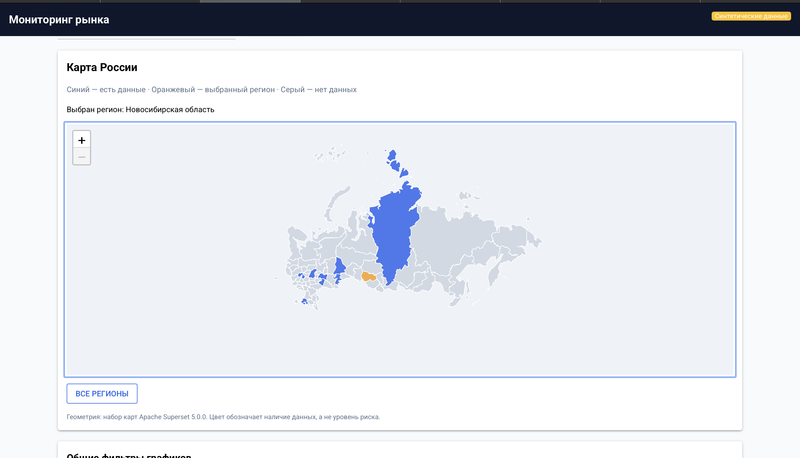
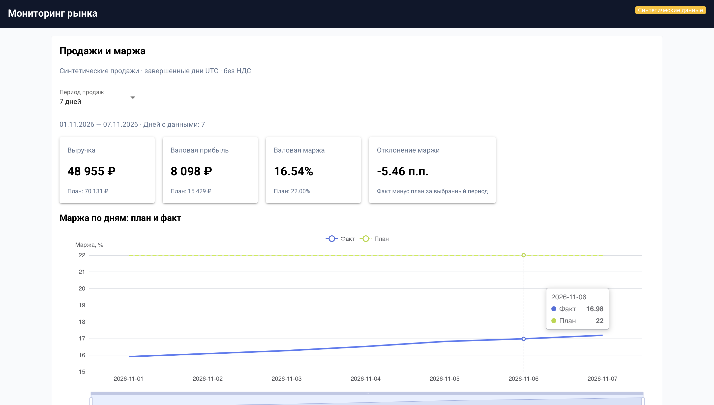
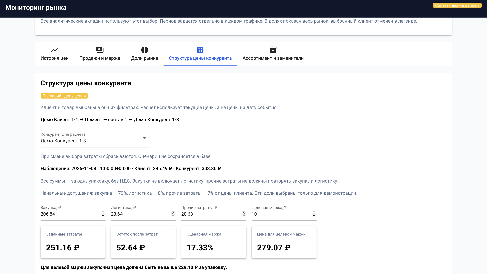
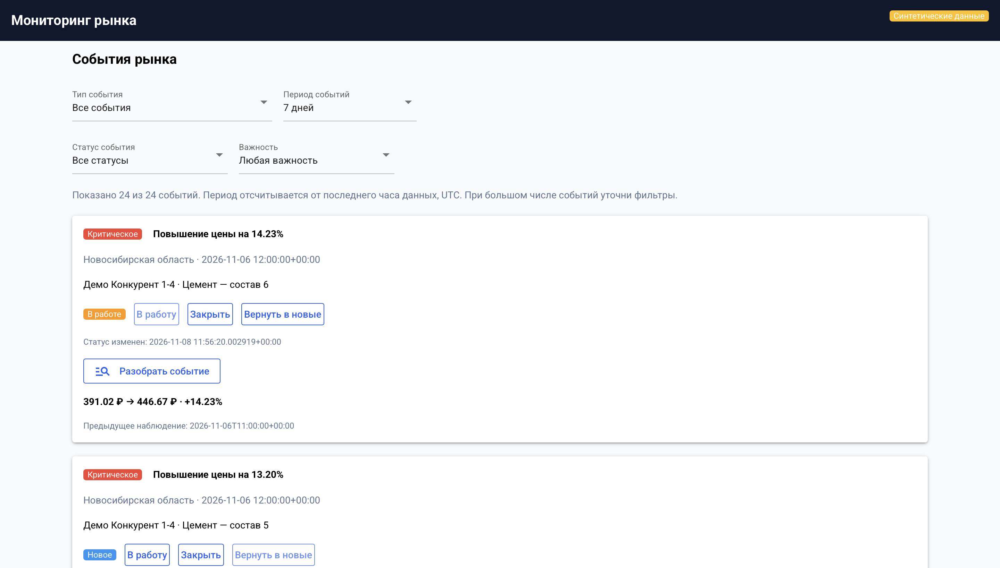
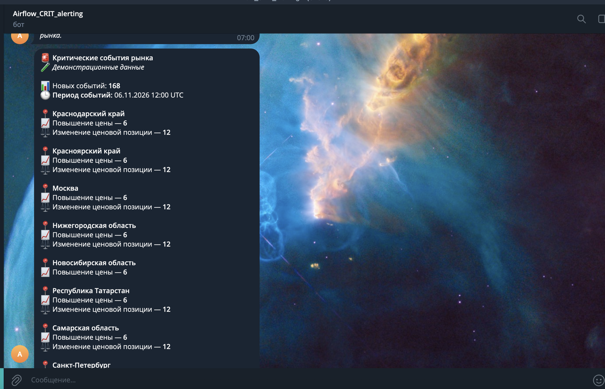

# Market Dashboard

Веб-платформа для анализа конкурентной среды: от выбора региона на карте до оценки маржинальности и обработки рыночных сигналов. Объединяет аналитику и уведомления в одном рабочем процессе.

Демонстрационная версия работает на синтетических данных с регулярным обновлением через Apache Airflow.

## Возможности

- Интерактивная карта регионов и общие фильтры.
- История цен с детализацией по часам и дням.
- Продажи, плановая и фактическая маржинальность.
- Расчётные доли рынка.
- Сценарный калькулятор структуры цены конкурента.
- Ассортимент и потенциальные заменители.
- События рынка, статусы обработки и Telegram-уведомления.

## Дашборд в действии

Ниже — реальные снимки демонстрационной версии. Значения на экранах относятся к синтетическим данным и иллюстрируют работу аналитики.

### 1. Карта регионов — точка входа в анализ

Карта показывает географию доступных наблюдений и позволяет выбрать территорию для дальнейшего анализа. Синим отмечены регионы с данными, оранжевым — выбранный регион, серым — территории без данных. Кнопка «Все регионы» снимает ограничение по территории.

**Для чего:** быстро перейти от общей географии мониторинга к конкретному региону и изучать его показатели через общие фильтры. Цвет карты отражает наличие данных, а не уровень риска.

### 2. Продажи и маржа — контроль выполнения плана

Раздел объединяет выручку, валовую прибыль, валовую маржу и отклонение маржи от плана. Пользователь выбирает период, а график показывает плановую и фактическую маржу по дням. Расчёты выполняются за завершённые дни UTC, суммы представлены без НДС.

**Для чего:** увидеть, где финансовый результат отстаёт от целевого, и определить период для дальнейшего разбора. На примере фактическая маржа составляет 16,54% при плане 22% — отклонение равно −5,46 процентного пункта.

### 3. Структура цены конкурента — проверка сценариев

Калькулятор использует выбранные в общих фильтрах клиента и товар, позволяет выбрать конкурента и задать предположения о закупке, логистике, прочих затратах и целевой марже. В ответ он рассчитывает суммарные затраты, остаток после затрат при цене конкурента, сценарную маржу, цену для целевой маржи и предельную закупочную цену.

**Для чего:** оценить, при каких затратах можно работать на сопоставимом уровне цен и сохранять требуемую маржинальность. Это инструмент проверки гипотез: фактическая себестоимость конкурента неизвестна, начальные доли затрат заданы для демонстрации. Используются текущие цены; сценарий не сохраняется в базе, а при смене выбора затраты сбрасываются.

### 4. События рынка — от сигнала к разбору

Лента собирает обнаруженные изменения и позволяет отбирать их по типу, периоду, статусу и важности. Карточка содержит регион, время, компанию, товар и величину изменения. Событие можно взять в работу, закрыть или вернуть в новые; кнопка «Разобрать событие» открывает подробности для анализа.

**Для чего:** выделить существенные изменения и отслеживать их обработку. На скриншоте показано повышение цены с 391,02 до 446,67 ₽ (+14,23%): сигнал помечен как критический и уже взят в работу.

### 5. Telegram — критические сигналы вне дашборда

Бот отправляет сводку новых критических событий: общее количество, период наблюдения и группировку по регионам и типам изменений. Заголовки и эмодзи помогают быстро просмотреть сообщение. Отправка встроена в обработку данных Airflow; статусы и попытки доставки учитываются в базе.

**Для чего:** узнавать о значимых изменениях без постоянно открытого дашборда, а затем переходить к подробному разбору в веб-интерфейсе. На примере показана сводка из 168 событий; это иллюстрация демонстрационного сценария, а не оценка реального рынка.

## Технологии

Python, NiceGUI, Leaflet, PostgreSQL, Apache Airflow,
Docker Compose. Для внешнего доступа — Caddy.

## Структура

- `app/` — веб-приложение.
- `airflow/dags/` — обработка данных и уведомления.
- `sql/` — схема БД и аналитические представления.
- `compose.yaml`, `compose.override.yaml` — сервисы приложения.
- `public-access/` — отдельный HTTPS-прокси, если настроен.

## Настройка окружения

Скопируйте `.env.example` в `.env` и заполните значения.
Пароли БД, Fernet-ключ и JWT-секрет необходимо создавать отдельно.

Для полного запуска также необходимы:

- каталог конфигурации Airflow и файл его пользователей/паролей;
- секреты Telegram в `secrets/telegram_token`
  и `secrets/telegram_chat_id`;
- инициализация метаданных Airflow;
- применение SQL-миграций в порядке нумерации.

Простой запуск Compose без подготовки этих компонентов недостаточен.
Секреты, данные БД и журналы в репозиторий не входят.

Для HTTPS скопируйте `public-access/Caddyfile.example` в
`public-access/Caddyfile`, задайте свой адрес и хеш пароля.
Проверьте имя внешней Docker-сети в конфигурации прокси.

## Демонстрационные данные

Данные синтетические. Доли рынка и структура цены — модельные
оценки. Гипотезы и заменители требуют проверки на реальных данных.
